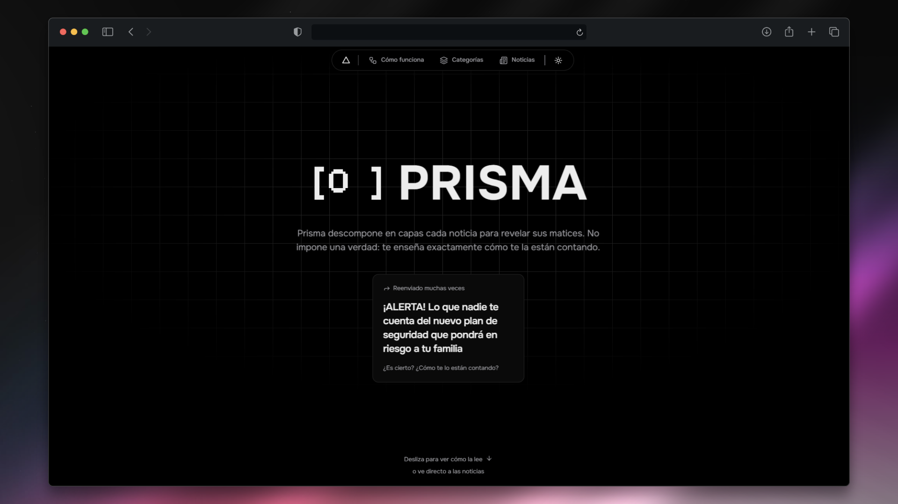

<div align="center">

# Prisma

*El conocimiento es poder.*

Prisma descompone una noticia en capas para mostrar **cómo** te la están contando, no solo **qué** te cuentan. Pega un titular y su texto, y Prisma lo analiza con [Laya](https://github.com/NandhaKishorM/laya) para ubicarlo en cuatro planos, cada uno con su evidencia y su nivel de confianza.

[**Demo en vivo**](https://aiprisma.vercel.app)




</div>

---

## Contenido

- [Cómo funciona](#cómo-funciona)
- [Qué analiza](#qué-analiza)
- [Stack](#stack)
- [Estructura](#estructura)
- [Cómo ejecutarlo](#cómo-ejecutarlo)
- [Despliegue](#despliegue)
- [Límites](#límites)
- [Autores](#autores)

## Cómo funciona

### Dos modos de análisis

El modo se elige con `VITE_ANALYSIS_MODE`.

| Modo | Dónde corre Laya | Cuándo usarlo |
| --- | --- | --- |
| `browser` (por defecto) | En el navegador de quien visita la página | Para alojar el sitio como estático y gratis, sin servidor de IA |
| `api` | En el backend de FastAPI | Para desarrollo o si quieres centralizar el análisis |

**Modo `browser`**

- Usa [`laya-ts`](frontend/vendor/README.md) con [ONNX Runtime Web](https://onnxruntime.ai): WebGPU, o WASM si no hay una GPU compatible.
- El modelo (`VITE_LAYA_MODEL_URL`, ~1.3 GB) se descarga **solo cuando el usuario pulsa "Descargar y activar Laya"**. Queda guardado en el navegador (CacheStorage), así que solo se descarga una vez.
- La URL apunta a una exportación ONNX en Hugging Face fijada a un commit, no a `main`: como el navegador guarda el modelo en caché, no se enteraría de los cambios. Para no depender de esa copia, exporta la tuya con `laya-ts/scripts/export_onnx.py`, súbela a Hugging Face y cambia la variable.

**Preguntas y conversión a capas.** Las preguntas que se le hacen a Laya y la conversión de sus respuestas a capas existen en dos lugares. **Si cambias una, cambia la otra.**

| | Frontend (TypeScript) | Backend (Python) |
| --- | --- | --- |
| Preguntas | `frontend/src/lib/laya/questions.ts` | `backend/app/questions/laya.py` |
| Conversión | `frontend/src/lib/laya/mapper.ts` | `backend/app/api/mappers/` |

## Qué analiza

### Capas

Cada capa es un plano con dos ejes opuestos. Laya da un valor entre -100% y +100% por eje, y la noticia queda como una flecha que sale del centro: una flecha larga es una inclinación fuerte; una corta, una noticia casi neutral en esa capa.

| Capa | Ejes | Qué mide |
| --- | --- | --- |
| **Sustento** | hechos ↔ opinión · fuentes verificables ↔ sin fuentes | Qué tan respaldado está lo que dice |
| **Tono** | sobrio ↔ sensacionalista · esperanza ↔ miedo | Cómo te quiere hacer sentir |
| **Intención** | informar ↔ persuadir · equilibrado ↔ de un solo lado | Si busca informar o convencer, y si da voz a varias partes |
| **Política** | izquierda ↔ derecha · libertario ↔ autoritario | Hacia dónde empuja el texto en lo económico y lo social |

### Temas y alertas

- **Temas:** se reparten y suman 100% (por ejemplo, 55% economía, 30% política y 15% sociedad).
- **Alertas:** probabilidad de que el texto use cada técnica de manipulación: clickbait, lenguaje cargado, apelación al miedo, "nosotros contra ellos", ataque personal y generalización. Pueden estar varias altas a la vez, o ninguna.

### Qué no es

Prisma no es un verificador de datos ni un árbitro de la verdad. Una IA puede equivocarse o inclinarse sin querer, y las personas tampoco siempre coinciden al juzgar un sesgo. Por eso cada resultado muestra su nivel de confianza: para discutirlo, no para aceptarlo sin más.


## Stack

**Frontend**

- [React 19](https://react.dev) + [TypeScript](https://www.typescriptlang.org)
- [Vite](https://vite.dev)
- [Tailwind CSS 4](https://tailwindcss.com)
- [Three.js](https://threejs.org) para la escena 3D de las capas, y CSS 3D para la introducción
- [laya-ts](frontend/vendor/README.md) + ONNX Runtime Web para el análisis en el navegador
- [lucide-react](https://lucide.dev) para los íconos

**Backend**

- [Python](https://www.python.org) + [FastAPI](https://fastapi.tiangolo.com)
- [Laya](https://github.com/NandhaKishorM/laya) (checkpoint multilingüe)
- [pytest](https://pytest.org) para los tests

## Estructura

```
prisma/
├── frontend/
│   ├── public/               # Favicon e imagen de vista previa
│   ├── vendor/               # Paquete laya-ts y su parche
│   └── src/
│       ├── sections/         # Secciones de la página (Header, ScrollStory, NewsExplorer, Footer)
│       ├── components/       # Escena 3D, ojo, planos, paneles y UI
│       ├── data/             # Capas, etiquetas y noticias de ejemplo
│       ├── lib/
│       │   ├── laya/         # Laya en el navegador: motor, preguntas y conversión
│       │   ├── analysis.ts   # Elige entre modo browser y api
│       │   └── api.ts        # Cliente del backend
│       └── types.ts          # Tipos compartidos
└── backend/
    ├── app/
    │   ├── main.py           # App de FastAPI, CORS y carga del modelo
    │   ├── api/routes/       # Endpoints (/health, /analysis)
    │   ├── api/mappers/      # Conversión de respuestas de Laya a capas, temas y alertas
    │   └── questions/        # Preguntas que se le hacen a Laya
    ├── tests/                # Tests de endpoints y mappers
    ├── prueba_laya.py        # Prueba las preguntas sin levantar la API
    └── requirements.txt
```

## Cómo ejecutarlo

### Requisitos

- [Node.js](https://nodejs.org) 22 o superior
- [pnpm](https://pnpm.io) (`npm install -g pnpm`)
- Solo para el backend:
  - [Python](https://www.python.org) 3.10 o superior (probado con 3.13)
  - Unos 2 GB libres en disco para el modelo de Laya, que se descarga la primera vez en `~/.cache/huggingface`

### Frontend

```bash
cd frontend
cp .env.example .env
pnpm install
pnpm dev
```

La aplicación queda en http://localhost:5173.

#### Variables de entorno

| Variable | Modo | Descripción |
| --- | --- | --- |
| `VITE_ANALYSIS_MODE` | — | `browser` (por defecto) o `api` |
| `VITE_LAYA_MODEL_URL` | `browser` | Carpeta con `encoder.onnx`, `head.onnx`, `tokenizer.json` y `rl_agent_config.json`, fijada a un commit |
| `VITE_API_URL_LOCAL` | `api` | URL del backend, por ejemplo `http://localhost:8000` |

#### Scripts

| Comando | Descripción |
| --- | --- |
| `pnpm dev` | Servidor de desarrollo con recarga en caliente |
| `pnpm build` | Revisa los tipos y genera la versión de producción en `dist/` |
| `pnpm preview` | Sirve localmente la versión de producción |

### Backend

Solo hace falta para el modo `api`.

```bash
cd backend
python -m venv venv
```

Activa el entorno virtual:

```bash
# Windows (PowerShell)
venv\Scripts\Activate.ps1

# macOS / Linux
source venv/bin/activate
```

> Si PowerShell bloquea el script de activación, ejecuta una vez `Set-ExecutionPolicy -Scope CurrentUser RemoteSigned`.

Instala las dependencias y arranca la API:

```bash
pip install -r requirements.txt
uvicorn app.main:app --reload
```

La API queda en http://localhost:8000. El modelo se carga una sola vez al arrancar, así que tarda unos segundos en estar lista (más la primera vez, por la descarga).

> Con `--reload` el modelo se vuelve a cargar cada vez que guardas un archivo. Si ves un `KeyboardInterrupt` en la terminal, es por eso y no es un error.

#### Endpoints

| Método | Ruta | Descripción |
| --- | --- | --- |
| `GET` | `/health` | Indica si la API está viva y si el modelo ya cargó (`model_loaded`) |
| `POST` | `/analysis` | Analiza una noticia y devuelve sus capas, temas y alertas |

Ejemplo de cuerpo para `/analysis`. El campo `body` debe tener al menos 300 caracteres; si no, la API responde `422`.

```json
{
  "new": "Titular de la noticia",
  "body": "Texto completo de la noticia..."
}
```

La forma más fácil de probarla es la documentación interactiva en http://localhost:8000/docs. Recuerda reemplazar el texto de ejemplo (`"string"`) por una noticia real.

#### Tests

```bash
cd backend
pytest
```

#### Probar las preguntas sin la API

Para ajustar las preguntas de `app/questions/laya.py` sin levantar el servidor:

```bash
cd backend
python prueba_laya.py
```

## Despliegue

En modo `browser` el frontend es un sitio estático: se despliega en [Vercel](https://vercel.com) (o cualquier hosting estático) con `frontend/` como raíz, `pnpm build` como comando de build y `dist/` como carpeta de salida. Configura `VITE_ANALYSIS_MODE` y `VITE_LAYA_MODEL_URL` en las variables de entorno del proyecto.

## Límites

- **Primera carga pesada:** en modo `browser` el modelo pesa ~1.3 GB. Conviene usar WiFi y un computador, no un celular.
- **Resultados del lado del cliente:** como la clasificación ocurre en el navegador, sus resultados no son confiables si algún día se guardan en una base de datos compartida. En ese caso habría que reclasificar en el servidor.
- **La IA se equivoca:** los puntajes son una lectura del modelo, no un veredicto. Por eso cada resultado trae su nivel de confianza.

## Autores

Proyecto universitario desarrollado por:

- **Maickol Rivera** ([@MaickolRivera](https://github.com/MaickolRivera))
- **SergioAle** ([@SergiAle](https://github.com/SergiAle))
